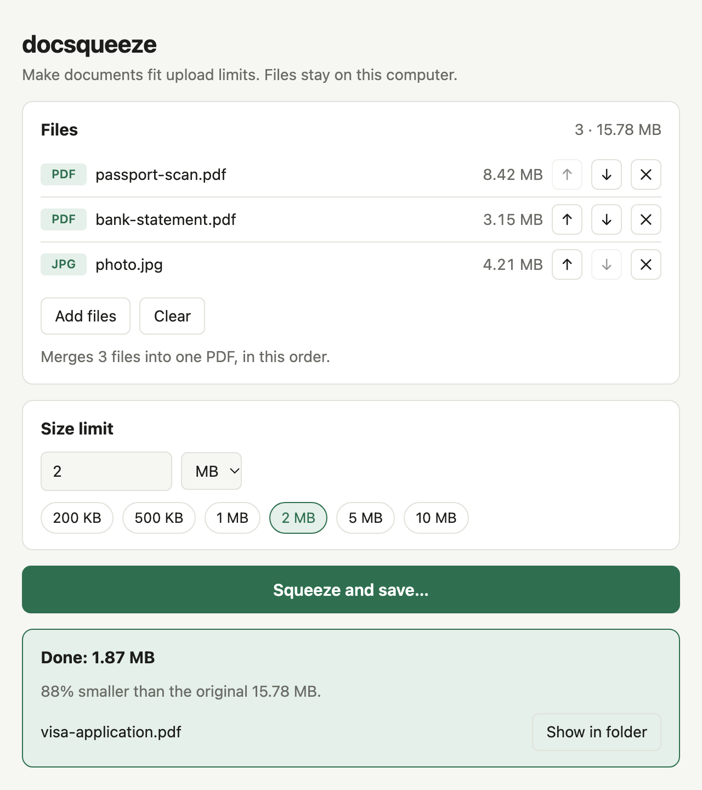

# docsqueeze

Make documents fit upload limits. Compress PDFs, scans and photos to an exact
size (e.g. under 2 MB) and merge them into one PDF for visa, immigration,
university and government portals. Works offline, so your files never leave
your computer.



## Install

Requires [Rust](https://rustup.rs).

```sh
cargo install --path .                   # command line only
cargo install --path . --features gui    # also installs docsqueeze-gui
```

## Desktop app

Run `docsqueeze-gui`. Drop PDFs or images on the window, put them in order,
pick a size limit and click **Squeeze and save**.

## Command line

```sh
docsqueeze [-o OUTPUT] <INPUTS>... <TARGET>
```

The target is in MB (1 MB = 1,000,000 bytes); use decimals for KB limits,
e.g. `0.5` for 500 KB.

```sh
# Shrink a PDF to 2 MB → scan-shrunk.pdf
docsqueeze scan.pdf 2

# Shrink a photo to 500 KB → photo-shrunk.jpg
docsqueeze photo.png 0.5

# Merge files, in order, into one PDF under 5 MB → passport-merged.pdf
docsqueeze passport.pdf statement.pdf photo.jpg 5

# Choose the output name; a .pdf output also turns a single image into a PDF
docsqueeze id-card.jpg 1 -o id-card.pdf
```

Supported inputs: PDF, JPEG, PNG, WebP, GIF, BMP and TIFF.

## How it works

Each step runs only if the file is still over the limit:

1. Lossless cleanup of the PDF.
2. Recompress embedded images, lowering quality and resolution as needed;
   text stays selectable.
3. Render each page to an image, which works for any scan format.

Images are saved as JPEG. If the limit can't be reached, the smallest
possible result is saved and the output is marked `-- above target`.
