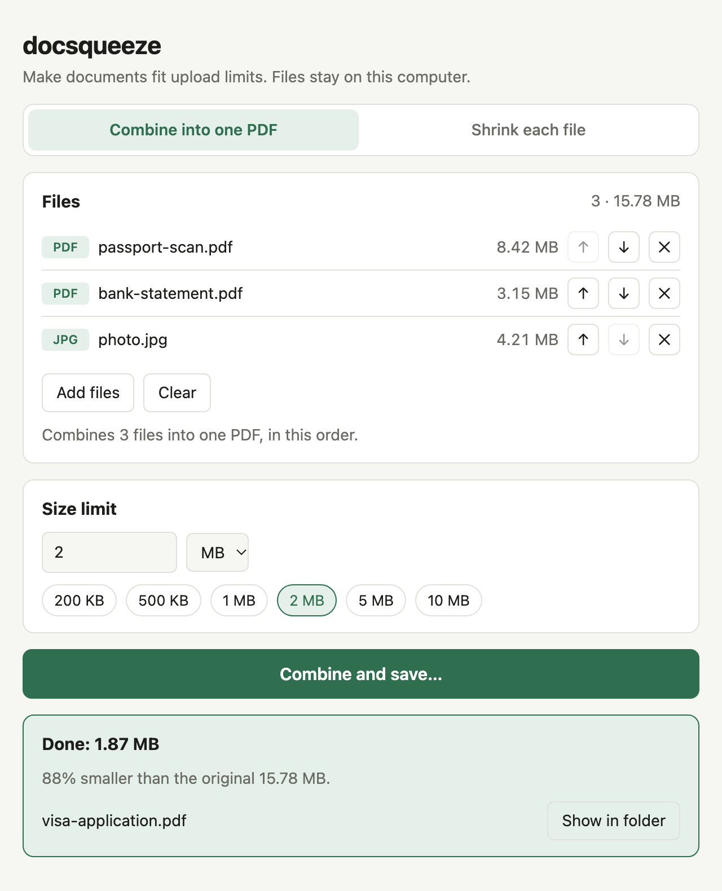
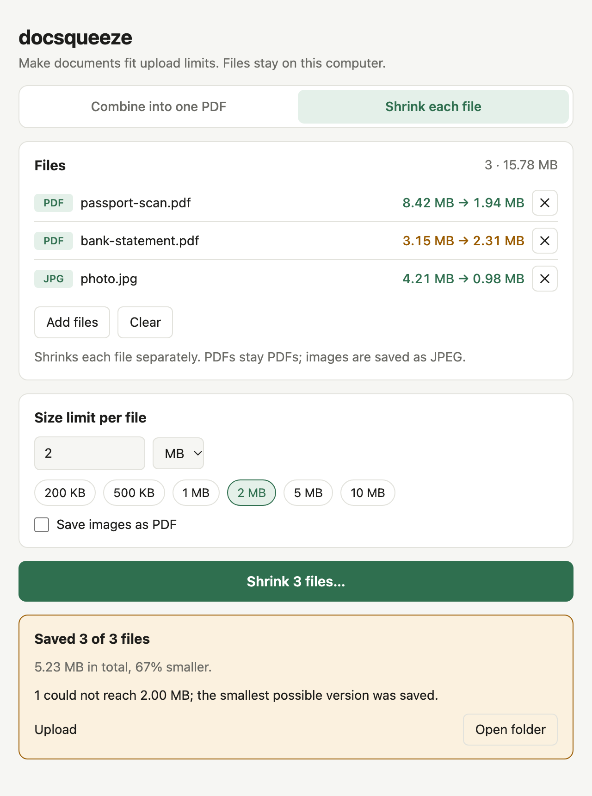

# docsqueeze

Make documents fit upload limits. Compress PDFs, scans and photos to an exact
size (e.g. under 2 MB) and merge them into one PDF for visa, immigration,
university and government portals. Works offline, so your files never leave
your computer.

<p>
  
  
</p>

## Download

Get the latest build from [Releases](../../releases):

| Platform | Desktop app | Command line |
|---|---|---|
| Windows | `…-windows-x64-setup.exe`, or the portable `.zip` | in the portable `.zip` |
| macOS (Apple Silicon and Intel) | `…-macos-universal.dmg` | `docsqueeze-cli-…-macos-universal.tar.gz` |
| Linux | `…-linux-x86_64.AppImage` | `docsqueeze-cli-…-linux-x86_64.tar.gz` |

The apps are not signed by Apple or Microsoft, so expect a warning on first
launch. On macOS, right-click the app and choose **Open**. On Windows, click
**More info → Run anyway**. On Linux, make the AppImage executable with
`chmod +x` first.

## Desktop app

Drop PDFs or images on the window and pick a size limit.

- **Combine into one PDF**: put the files in order and save them as a
  single PDF under the limit.
- **Shrink each file**: shrink every file separately to the limit and save
  the results to a folder, optionally converting images to PDF.

## Command line

```sh
docsqueeze_cli [-b] [-o OUTPUT] <INPUTS>... <TARGET>
```

The target is in MB (1 MB = 1,000,000 bytes); use decimals for KB limits,
e.g. `0.5` for 500 KB. Several inputs are merged into one PDF; with
`-b`/`--batch` each one is shrunk separately instead.

```sh
# Shrink a PDF to 2 MB → scan-shrunk.pdf
docsqueeze_cli scan.pdf 2

# Shrink a photo to 500 KB → photo-shrunk.jpg
docsqueeze_cli photo.png 0.5

# Merge files, in order, into one PDF under 5 MB → passport-merged.pdf
docsqueeze_cli passport.pdf statement.pdf photo.jpg 5

# Choose the output name; a .pdf output also turns a single image into a PDF
docsqueeze_cli id-card.jpg 1 -o id-card.pdf

# Shrink each file to 1 MB separately, saving the results into upload/
docsqueeze_cli --batch *.pdf *.jpg 1 -o upload
```

Supported inputs: PDF, JPEG, PNG, WebP, GIF, BMP and TIFF.

## Build from source

Requires [Rust](https://rustup.rs). On Linux, the desktop app also needs
WebKitGTK (`libwebkit2gtk-4.1-dev` and `libxdo-dev` on Debian/Ubuntu).

```sh
cargo install --path .                   # docsqueeze_cli only
cargo install --path . --features gui    # also installs the Docsqueeze app
```

`scripts/bundle-macos.sh` builds the universal macOS app and DMG locally.
Pushing a `v*` tag builds all platforms and publishes a release
(`.github/workflows/release.yml`).

## How it works

Each step runs only if the file is still over the limit:

1. Lossless cleanup of the PDF.
2. Recompress embedded images, lowering quality and resolution as needed;
   text stays selectable.
3. Render each page to an image, which works for any scan format.

Images are saved as JPEG. If the limit can't be reached, the smallest
possible result is saved and the output is marked `-- above target`.
